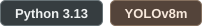
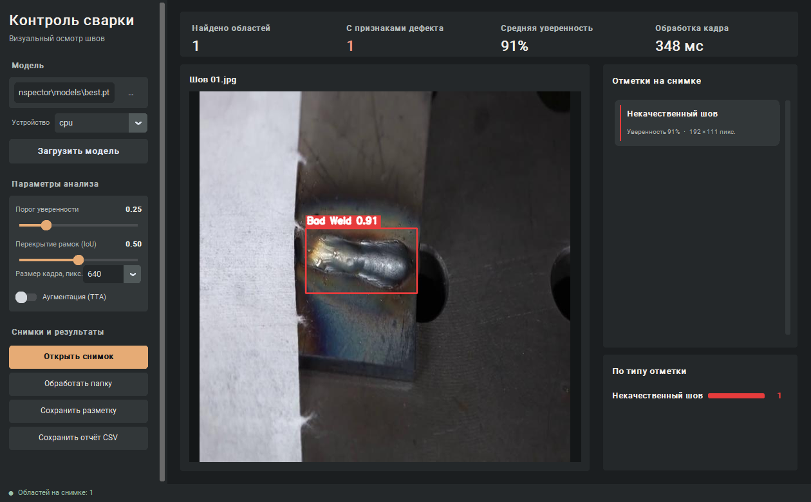

# Weld Inspector



Настольное приложение для осмотра сварных швов по фотографиям. Откройте снимок — модель выделит найденные участки рамками, а рядом с изображением появятся тип каждой отметки и уверенность модели. Для серии снимков можно выбрать папку и сохранить общий отчёт в CSV.



*На этом снимке рамка показывает участок, который модель отнесла к классу «Некачественный шов» с уверенностью 91%.*

## Запуск в Windows

После клонирования репозитория откройте PowerShell в его папке. Приложение проверено на Python 3.13 и CPU.

```powershell
py -3.13 -m venv .venv
.\.venv\Scripts\python.exe -m pip install -r requirements.txt
.\.venv\Scripts\python.exe welding_app.py
```

1. Нажмите **Загрузить модель**. Приложение подставит путь к обученным весам из `models/best.pt`.
2. Выберите **Открыть снимок** или **Обработать папку**. После обработки папки используйте стрелки над изображением для перехода между снимками.
3. Нажмите **Сохранить разметку**, чтобы получить JPEG или PNG. Для папки доступна кнопка **Сохранить отчёт CSV**. Каждая строка содержит имя файла, класс, уверенность, координаты рамки и время обработки. Снимки без отметок тоже входят в отчёт.

## Модель и результаты

Приложение использует YOLOv8m, обученную на трёх классах Welding Defect Dataset v2. Метки `Good Weld` и `Bad Weld` описывают участки шва, а `Defect` обозначает область дефекта.

> [!NOTE]
> Пустой список отметок означает, что ни одно предсказание не прошло выбранный порог уверенности. По такому результату нельзя судить о качестве шва.

| Метрика на валидационной выборке | Значение |
| --- | ---: |
| Precision | 0,706 |
| Recall | 0,695 |
| mAP@50 | 0,724 |
| mAP@50–95 | 0,454 |

Значения взяты из метаданных поставляемой модели. Динамику по эпохам можно посмотреть в [журнале обучения](docs/training.csv). В метаданных весов указана лицензия AGPL-3.0.

## Код

| Файл | Назначение |
| --- | --- |
| `welding_app.py` | Интерфейс на CustomTkinter, навигация по снимкам и экспорт результатов |
| `detector.py` | Загрузка модели, фильтрация предсказаний и отрисовка рамок |
| `train.py` | Локальное обучение с выбором модели, устройства и пресета |
| `data.yaml` | Имена классов и пути к обучающей, валидационной и тестовой выборкам |

Для запуска приложения достаточно весов из репозитория. Для собственного эксперимента подготовьте локальный датасет в формате YOLO и укажите его абсолютный путь в поле `path` файла `data.yaml`. Имена классов и порядок их индексов должны соответствовать разметке. Быстрый тренировочный запуск выполняется командой `python train.py --preset fast`.
